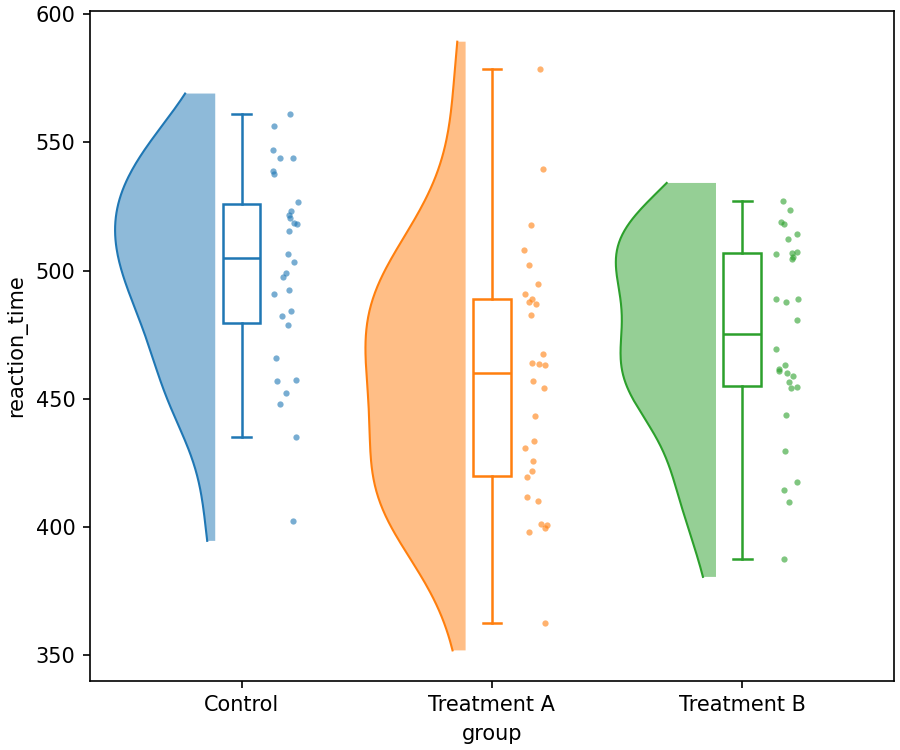
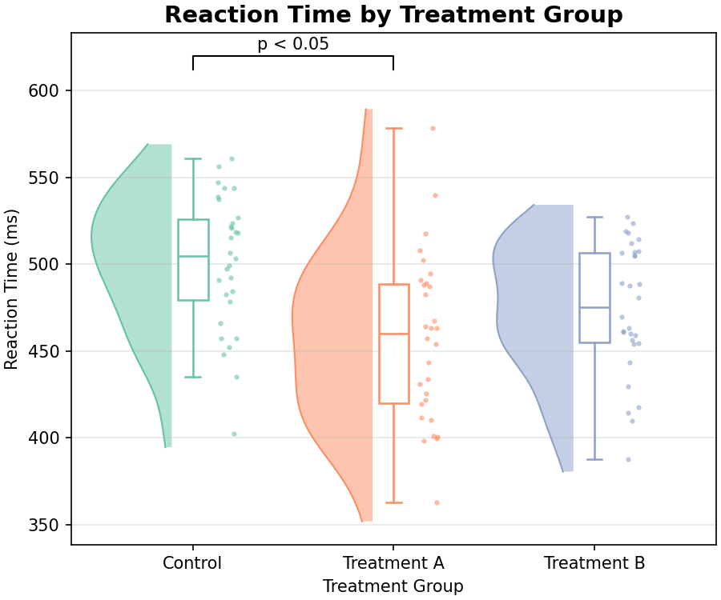
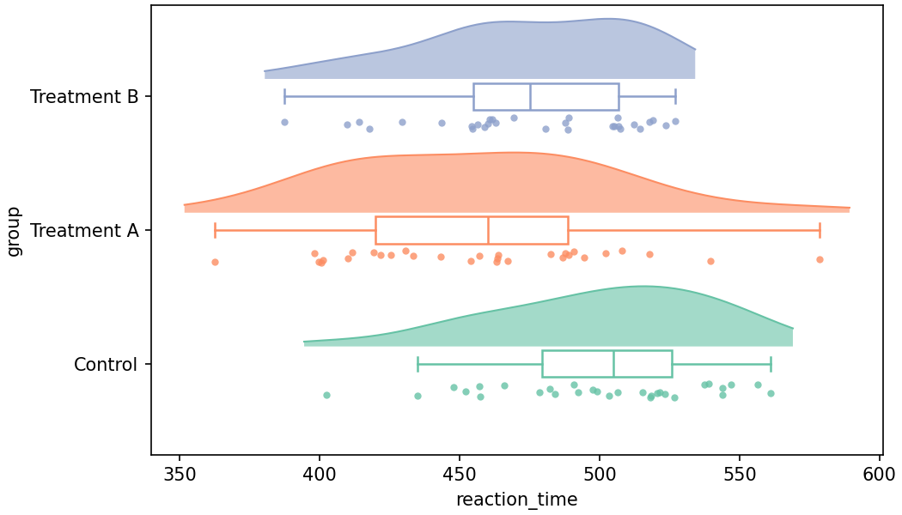
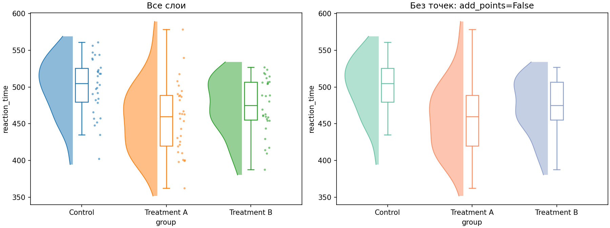
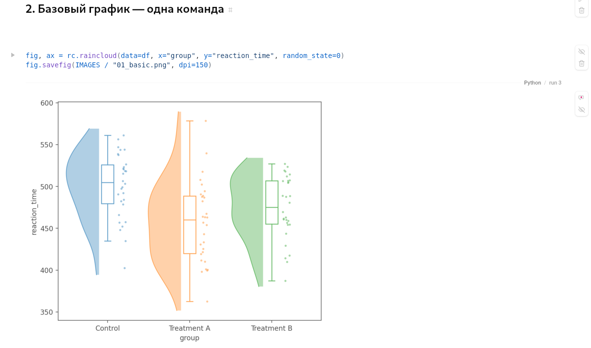

# PyRainCloud

Rain cloud plots из pandas DataFrame **одной командой**: облако плотности (half-violin) +
box plot + сырые точки с jitter («дождь»). Результат — обычные matplotlib `Figure` и `Axes`,
которые можно донастроить, подписать и сохранить в PNG/PDF.

```python
import pyraincloud as rc

fig, ax = rc.raincloud(data=df, x="group", y="reaction_time")
```



- API в стиле seaborn: `data=`, `x=`, `y=`
- работает локально, без сети; ничего не пишет на диск и не вызывает `plt.show()`
- Python ≥ 3.9, pandas ≥ 1.5, matplotlib ≥ 3.5, numpy, scipy
- лицензия MIT · текущая версия **0.1.0** (MVP), история изменений — [CHANGELOG.md](CHANGELOG.md)

---

## Установка

Пакет подготовлен к публикации на PyPI. До публикации ставьте из репозитория (git) или из
собранного wheel; после неё работает просто `pyraincloud` во всех командах ниже.

| Источник | Что подставлять вместо `<ИСТОЧНИК>` |
|---|---|
| PyPI (после публикации) | `pyraincloud` |
| Git-репозиторий | `"pyraincloud @ git+https://github.com/noki1928/PyRainCloud.git"` |
| Локальная папка с исходниками | `./pyraincloud` (путь к папке) |
| Собранный wheel | `dist/pyraincloud-0.1.0-py3-none-any.whl` |

### uv (рекомендуется)

```bash
# добавить в свой uv-проект
uv add <ИСТОЧНИК>

# или разово запустить скрипт без создания проекта
uv run --with <ИСТОЧНИК> python my_plot.py

# или в обычное venv, созданное uv
uv venv && uv pip install <ИСТОЧНИК>
```

### pip + venv

Linux / macOS:

```bash
python3 -m venv .venv
source .venv/bin/activate
pip install <ИСТОЧНИК>
```

Windows (PowerShell):

```powershell
py -m venv .venv
.venv\Scripts\Activate.ps1
pip install <ИСТОЧНИК>
```

### conda / mamba

Conda-пакета пока нет: зависимости ставятся из conda-forge, сама библиотека — через pip внутри
окружения.

```bash
conda create -n raincloud -c conda-forge python=3.11 numpy pandas scipy matplotlib
conda activate raincloud
pip install <ИСТОЧНИК>
```

### Poetry

```bash
poetry add <ИСТОЧНИК>     # для git: poetry add git+https://github.com/noki1928/PyRainCloud.git
```

### Pipenv

```bash
pipenv install <ИСТОЧНИК>
```

### Jupyter / JupyterLab / Google Colab

В ячейке ноутбука (ставит пакет в ядро, в котором открыт ноутбук):

```python
%pip install <ИСТОЧНИК>
```

Если ядро — это uv- или conda-окружение, удобнее поставить пакет командой из соответствующего
раздела выше и выбрать это окружение как kernel.

### Проверка установки

```bash
python -c "import pyraincloud as rc; print(rc.__version__)"
```

---

## Быстрый старт

```python
import numpy as np
import pandas as pd
import matplotlib.pyplot as plt
import pyraincloud as rc

rng = np.random.default_rng(42)
df = pd.DataFrame(
    {
        "group": ["Control"] * 30 + ["Treatment A"] * 30 + ["Treatment B"] * 30,
        "reaction_time": np.concatenate(
            [
                rng.normal(500, 50, 30),
                rng.normal(450, 60, 30),
                rng.normal(480, 55, 30),
            ]
        ),
    }
)

fig, ax = rc.raincloud(
    data=df,
    x="group",
    y="reaction_time",
    orient="v",
    palette=["#66c2a5", "#fc8d62", "#8da0cb"],
    cloud_alpha=0.5,
    cloud_width=0.8,
    point_size=3,
    point_alpha=0.6,
    random_state=0,  # воспроизводимый jitter
)

ax.set_title("Reaction Time by Treatment Group", fontsize=14, fontweight="bold")
ax.set_xlabel("Treatment Group")
ax.set_ylabel("Reaction Time (ms)")
ax.annotate("p < 0.05", xy=(0.5, 622), ha="center")

fig.savefig("raincloud_plot.pdf", dpi=300, bbox_inches="tight")
plt.show()  # в Jupyter не нужно — график отобразится сам
```



Данные — в «длинном» формате: одна строка = одно наблюдение, колонка `x` — группа,
колонка `y` — число. Порядок групп — порядок появления в данных, а для `pd.Categorical` —
порядок категорий.

### Горизонтальная ориентация и кастомизация

```python
fig, ax = rc.raincloud(
    data=df,
    x="group",
    y="reaction_time",
    orient="h",
    palette=["#66c2a5", "#fc8d62", "#8da0cb"],
    cloud_alpha=0.6,
    cloud_width=0.9,
    point_size=4,
    point_alpha=0.8,
    box_width=0.2,
)
```



### Рисование на своих осях

```python
fig, (ax1, ax2) = plt.subplots(1, 2, figsize=(12, 5))
rc.raincloud(data=df_session1, x="group", y="score", ax=ax1)
rc.raincloud(data=df_session2, x="group", y="score", ax=ax2)
```



### Пошаговый ноутбук

[examples/quickstart.ipynb](examples/quickstart.ipynb) — весь путь пользователя с результатами
выполнения: данные → базовый график → настройка → подписи и экспорт → несколько осей →
ошибки и предупреждения. Открывается в Jupyter, JupyterLab, VS Code, nteract и прямо на GitHub.



---

## API

```python
rc.raincloud(data, x, y, *, orient="v", palette=None, cloud_alpha=0.5, cloud_width=0.8,
             point_size=3.0, point_alpha=0.6, box_width=0.15, add_boxes=True,
             add_points=True, ax=None, random_state=None) -> tuple[Figure, Axes]
```

| Параметр | Что это | По умолчанию |
|---|---|---|
| `data` | `pandas.DataFrame` с колонками `x` и `y` | обязателен |
| `x` | имя категориальной колонки (группы) | обязателен |
| `y` | имя числовой колонки (значения) | обязателен |
| `orient` | `'v'` — группы по X, значения по Y; `'h'` — наоборот | `'v'` |
| `palette` | список цветов, не короче числа групп; `None` — цвета matplotlib | `None` |
| `cloud_alpha` | прозрачность облака, `[0, 1]` | `0.5` |
| `cloud_width` | максимальная ширина облака, `> 0` | `0.8` |
| `point_size` | размер точек (как `markersize`), `> 0` | `3.0` |
| `point_alpha` | прозрачность точек, `[0, 1]` | `0.6` |
| `box_width` | ширина box plot, `> 0` | `0.15` |
| `add_boxes` | рисовать box plot | `True` |
| `add_points` | рисовать точки | `True` |
| `ax` | существующие `Axes`; `None` — создать новую фигуру | `None` |
| `random_state` | `int` или `numpy.random.Generator` для воспроизводимого jitter | `None` |

Раскладка: при `orient='v'` облако слева от позиции группы, box по центру, точки справа;
при `orient='h'` облако сверху, точки снизу. Box plot рисуется без выбросов — все наблюдения
и так видны как точки; усы — 1.5·IQR.

### Ошибки

| Ситуация | Исключение | Сообщение |
|---|---|---|
| нет колонки | `ValueError` | `Column 'group' not found in data` |
| в `y` нет ни одного числа | `TypeError` | `Column 'y' must be numeric` |
| `orient='z'` | `ValueError` | `orient must be 'v' or 'h'` |
| `cloud_alpha=1.5` | `ValueError` | `cloud_alpha must be in [0, 1]` |
| пустой DataFrame | `ValueError` | `data is empty` |
| все значения NaN | `ValueError` | `No valid observations after dropping NaN` |
| палитра короче числа групп | `ValueError` | `palette has 1 colour(s) but data has 3 group(s)...` |

### Предупреждения (`pyraincloud.RaincloudWarning`)

- нечисловые значения в `y` (например, `"n/a"`) приведены к NaN — `pd.to_numeric(errors="coerce")`;
- отброшены NaN в `y` или строки без группы;
- группа из 1 значения или с нулевой дисперсией — облако для неё не рисуется (box и точка остаются);
- малая выборка (n < 5) — оценка плотности может быть неточной;
- больше 50 000 точек — отрисовка может быть медленной;
- больше 50 групп — график может быть нечитаемым.

Отключить: `warnings.filterwarnings("ignore", category=rc.RaincloudWarning)`.

---

## Разработка

Проект ведётся через [uv](https://docs.astral.sh/uv/).

```bash
uv sync                       # окружение + dev-зависимости
uv run pytest -q              # тесты
uv run ruff check src tests   # линтер
uv run ruff format src tests  # форматирование
uv run python examples/quickstart.py   # пример-скрипт → examples/raincloud_plot.pdf/.png
uv run python docs/build_user_guide.py # инструкция пользователя .docx по шаблону
uv build                      # sdist + wheel в dist/
uvx twine check dist/*        # проверка перед публикацией
```

Без uv:

```bash
python -m venv .venv && source .venv/bin/activate
pip install -e ".[dev]"
pytest -q
python -m build
```

Публикация на PyPI: `uv publish` (или `twine upload dist/*`) с токеном PyPI.

### Структура

```
src/pyraincloud/
├── __init__.py    # публичный API: raincloud, RaincloudWarning
├── plot.py        # оркестрация: валидация → KDE → слои → (fig, ax)
├── data.py        # проверка DataFrame, приведение типов, NaN, порядок групп
├── density.py     # gaussian_kde → геометрия half-violin
├── artists.py     # отрисовка облака, box plot и точек
├── style.py       # значения по умолчанию, палитра, проверка параметров
└── exceptions.py  # RaincloudWarning
tests/             # unit + интеграционные тесты (US1–US3, граничные случаи)
└── fixtures/      # тестовый набор reaction_times.csv (критерии приёмки)
examples/          # quickstart.ipynb (ноутбук), quickstart.py (скрипт), raincloud_plot.pdf/.png
docs/
├── images/        # графики для README (рисуются ноутбуком examples/quickstart.ipynb)
├── screens/       # скриншоты из nteract и терминала для инструкции
└── Инструкция_пользователя_PyRainCloud.docx  # + build_user_guide.py, template/
```

## Ограничения MVP

Не входит в 0.1.0 (по ТЗ):

- статистические аннотации и p-value — делаются через возвращённый `ax`;
- автоматический расчёт статистики (t-test, ANOVA);
- facet / subplot-сетка из коробки — используйте `ax=` с `plt.subplots`;
- интерактивный HTML-экспорт и Plotly;
- пакетная обработка и стилевые пресеты;
- conda-пакет, плагины IDE, GUI.

Прореживание точек на больших наборах не реализовано: при числе точек больше 50 000
выводится предупреждение, а прореживать данные для отображения нужно самостоятельно,
например `df.groupby("group").sample(n=2000, random_state=0)`, или передать
`add_points=False`. Облако и ящик в любом случае считаются по всем данным.

## Лицензия

MIT
