# Инструкция пользователя PyRainCloud

**Проект:** PyRainCloud 0.1.0 — Python-библиотека rain cloud plots\
**Репозиторий:** <https://github.com/noki1928/PyRainCloud> · **Релиз:** [v0.1.0](https://github.com/noki1928/PyRainCloud/releases/tag/v0.1.0)

*Цель документа: любой человек, не знакомый с проектом, должен суметь пройти весь путь от первого входа до получения результата, используя только эту инструкцию.*

## 0. Введение

- **Название проекта:** PyRainCloud — библиотека для построения rain cloud plots из pandas DataFrame одной командой (версия 0.1.0, лицензия MIT).
- **Ссылка на работающий MVP:** репозиторий <https://github.com/noki1928/PyRainCloud> — исходный код, README и пошаговый ноутбук `examples/quickstart.ipynb` с результатами выполнения. Готовый пакет (wheel и sdist) лежит в [релизе v0.1.0](https://github.com/noki1928/PyRainCloud/releases/tag/v0.1.0); пакет подготовлен к публикации на PyPI.
- **Для кого этот продукт:** для аспирантов, исследователей и аналитиков данных (психология, нейробиология, медицина, биология, A/B-тесты), которые работают в Python + pandas + matplotlib и сравнивают 2–10 групп по непрерывному показателю: время реакции, баллы, концентрации.
- **Что он делает:** строит rain cloud plot публикационного качества — облако плотности, box plot и сами наблюдения на одном графике — одной строкой кода прямо из DataFrame.
- **Сколько времени займёт знакомство:** около 5 минут до первого графика: 1–2 минуты на установку, минута на данные, сам график — одна строка кода и меньше секунды на построение.

**Что нужно заранее:** Python 3.9 или новее и любое привычное окружение — uv, pip + venv, conda, Poetry, Pipenv, Jupyter, nteract или Google Colab. Знание matplotlib не требуется.

**Как выглядит результат.** Каждая группа — это «облако» (оценка плотности распределения, слева), «ящик» (медиана и квартили, по центру) и «дождь» (каждое отдельное наблюдение, справа):

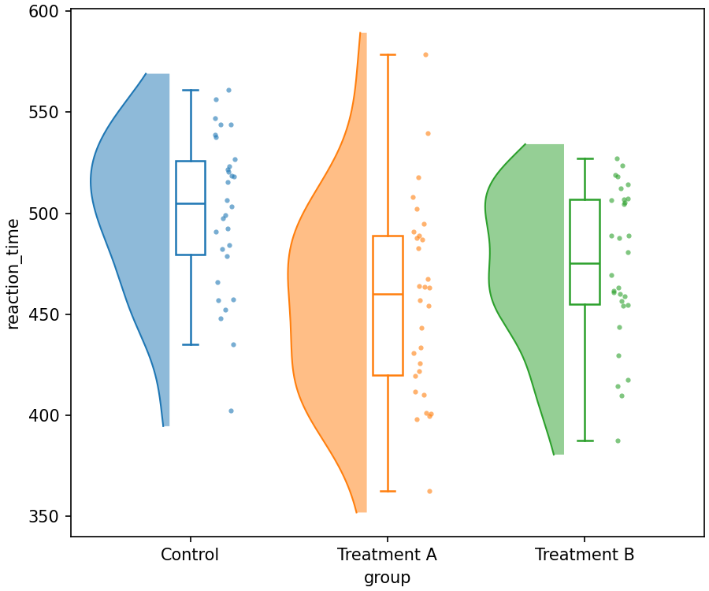

## 1. Первый вход в продукт

### Как попасть в продукт

PyRainCloud — это Python-библиотека, а не сайт или приложение: её устанавливают одной командой в своё окружение и импортируют в Jupyter Notebook, nteract, скрипте или IDE (VS Code, PyCharm).

Пакет ставится прямо из релиза на GitHub. Выберите команду для своего окружения:

| Окружение | Команда установки |
|---|---|
| uv | `uv add "pyraincloud @ git+https://github.com/noki1928/PyRainCloud@v0.1.0"` |
| pip + venv | `pip install "pyraincloud @ git+https://github.com/noki1928/PyRainCloud@v0.1.0"` |
| conda / mamba | сначала `conda install -c conda-forge numpy pandas scipy matplotlib`, затем команда для pip |
| Poetry | `poetry add git+https://github.com/noki1928/PyRainCloud.git#v0.1.0` |
| Pipenv | `pipenv install "pyraincloud @ git+https://github.com/noki1928/PyRainCloud@v0.1.0"` |
| Jupyter / nteract / Colab | `%pip install "pyraincloud @ git+https://github.com/noki1928/PyRainCloud@v0.1.0"` в ячейке |

После публикации на PyPI во всех командах достаточно написать просто `pyraincloud`. Подробности по каждому окружению, включая создание venv на Windows, — в README репозитория.

### Что нужно сделать на старте

- Регистрация, вход и ключи не нужны: библиотека работает полностью локально, без интернета — данные никуда не отправляются.
- Сразу вводить ничего не нужно. Проверьте установку — команда должна вывести `0.1.0`:

```bash
uv run python -c "import pyraincloud as rc; print(rc.__version__)"
```

### Что пользователь увидит первым

После `import pyraincloud as rc` доступна одна функция — `rc.raincloud(...)`. Её описание показывают `help(rc.raincloud)` или `rc.raincloud?` в Jupyter и nteract. Главный «экран» продукта — ячейка с вызовом функции и график под ней. Готовый ноутбук со всеми шагами этой инструкции — `examples/quickstart.ipynb` в репозитории.

### Скриншоты стартового экрана

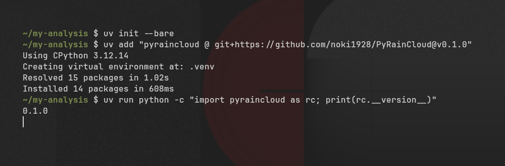

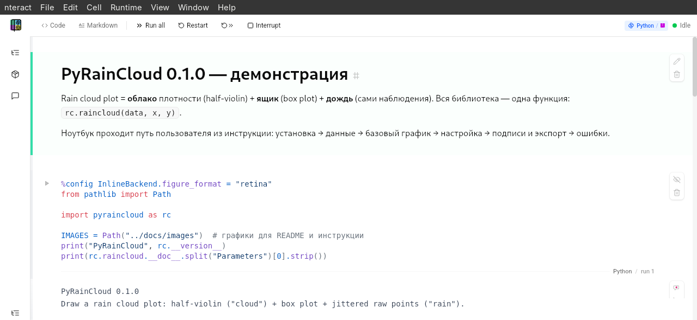

## 2. Основная функция №1 (Core-функция)

- **Название функции:** «Rain cloud plot одной командой» — `rc.raincloud(data, x, y)` рисует облако плотности, box plot и точки для каждой группы.
- **Зачем она нужна пользователю:** вручную такой график занимает 50+ строк кода на matplotlib и 2–3 часа на первую диаграмму. Здесь — одна строка и пара секунд, а на графике сразу видно распределение, медиану с квартилями и каждое наблюдение.

### Пошаговая инструкция

1. Подготовьте данные в pandas DataFrame в «длинном» формате: одна строка — одно наблюдение, колонка с названием группы и колонка с числом. Данные можно загрузить из файла: `df = pd.read_csv("data.csv")`.
2. Вызовите `fig, ax = rc.raincloud(data=df, x="group", y="reaction_time")`, подставив имена своих колонок, и запустите ячейку (Shift+Enter) или скрипт.
3. Библиотека проверяет данные, группирует их, оценивает плотность и рисует три слоя. Обычно это занимает меньше секунды; 10 групп по 5 000 точек — не дольше 2 секунд (проверяется автотестом).
4. График появляется под ячейкой (в обычном скрипте добавьте `plt.show()`), а в переменных `fig` и `ax` лежат стандартные объекты matplotlib для дальнейшей работы.

### Пример входных данных

Эксперимент с тремя группами по 30 испытуемых, у каждого измерено время реакции в миллисекундах:

```python
import numpy as np
import pandas as pd
import pyraincloud as rc

rng = np.random.default_rng(42)
df = pd.DataFrame({
    "group": ["Control"] * 30 + ["Treatment A"] * 30 + ["Treatment B"] * 30,
    "reaction_time": np.concatenate([rng.normal(500, 50, 30),
                                     rng.normal(450, 60, 30),
                                     rng.normal(480, 55, 30)]),
})

fig, ax = rc.raincloud(data=df, x="group", y="reaction_time")
```

### Пример результата

График из трёх групп в порядке их появления в данных. У каждой группы облако слева, ящик по центру и точки справа; подписи осей взяты из имён колонок. Пропуски (NaN) и нечисловые значения отбрасываются с предупреждением.

### Скриншоты каждого шага

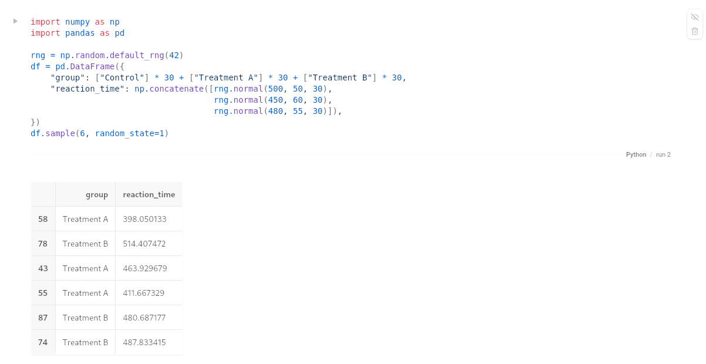

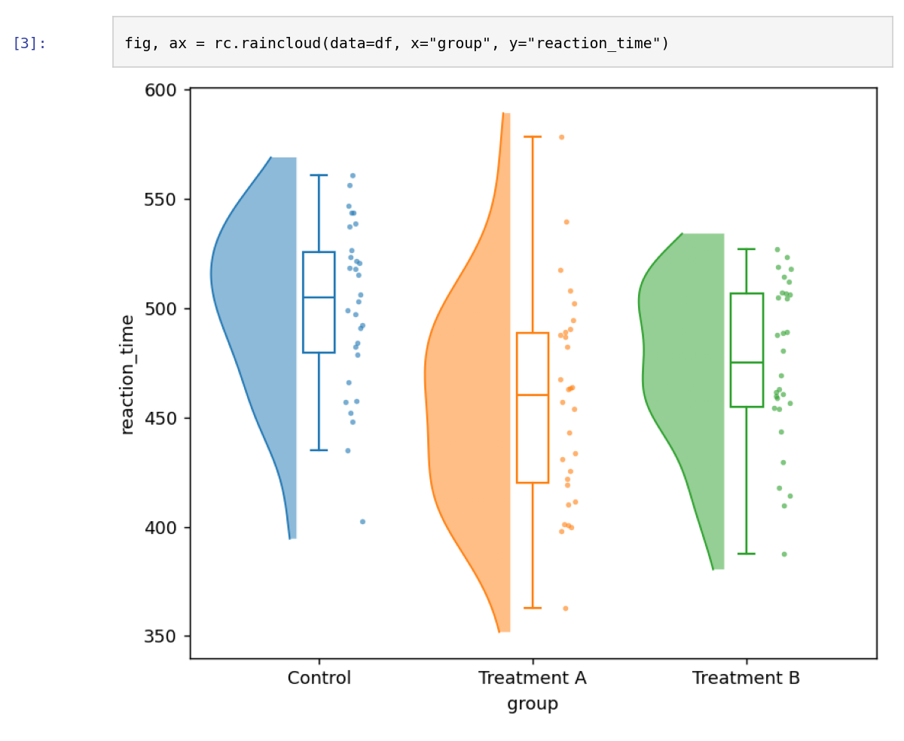

## 3. Основная функция №2

- **Название функции:** настройка внешнего вида — цвета, ориентация, прозрачность и размеры слоёв, включение и отключение ящиков и точек.
- **Зачем она нужна:** чтобы оформить серию графиков в едином стиле под требования журнала, развернуть график горизонтально при длинных названиях групп и получать одинаковую картинку при каждом запуске.

### Пошаговая инструкция

1. Выберите цвета групп: список HEX-кодов или названий, например `["#66c2a5", "#fc8d62", "#8da0cb"]`. Цветов должно быть не меньше, чем групп.
2. Добавьте в тот же вызов `rc.raincloud` нужные параметры из таблицы ниже, например `orient="h", cloud_alpha=0.6, point_size=4`.
3. Запустите ячейку — график перерисуется с новым оформлением. При неверном значении (например, `cloud_alpha=1.5`) библиотека сразу сообщит, какой параметр исправить.
4. Для серии графиков сохраните настройки в словарь и передавайте его в каждый вызов: `style = dict(palette=palette, cloud_alpha=0.6, point_size=4)`, затем `rc.raincloud(data=df, x=..., y=..., **style)`.

### Пример входных и выходных данных

Те же данные, горизонтальная ориентация и своя палитра:

```python
palette = ["#66c2a5", "#fc8d62", "#8da0cb"]
fig, ax = rc.raincloud(
    data=df, x="group", y="reaction_time",
    orient="h", palette=palette,
    cloud_alpha=0.6, cloud_width=0.9,
    point_size=4, point_alpha=0.8, box_width=0.2,
    random_state=0,          # одинаковое расположение точек при каждом запуске
)
```

Все параметры настройки:

| Параметр | Что меняет | По умолчанию |
|---|---|---|
| `orient` | `'v'` — группы по горизонтали, `'h'` — по вертикали | `'v'` |
| `palette` | список цветов, по одному на группу | цвета matplotlib |
| `cloud_alpha` | прозрачность облака, от 0 до 1 | `0.5` |
| `cloud_width` | максимальная ширина облака | `0.8` |
| `point_size` | размер точек | `3.0` |
| `point_alpha` | прозрачность точек, от 0 до 1 | `0.6` |
| `box_width` | ширина ящика | `0.15` |
| `add_boxes` | рисовать ли ящик (`True` / `False`) | `True` |
| `add_points` | рисовать ли точки (`True` / `False`) | `True` |
| `random_state` | число для одинакового разброса точек | `None` |
| `ax` | готовые оси matplotlib, на которых рисовать | `None` (новый график) |

### Скриншоты процесса

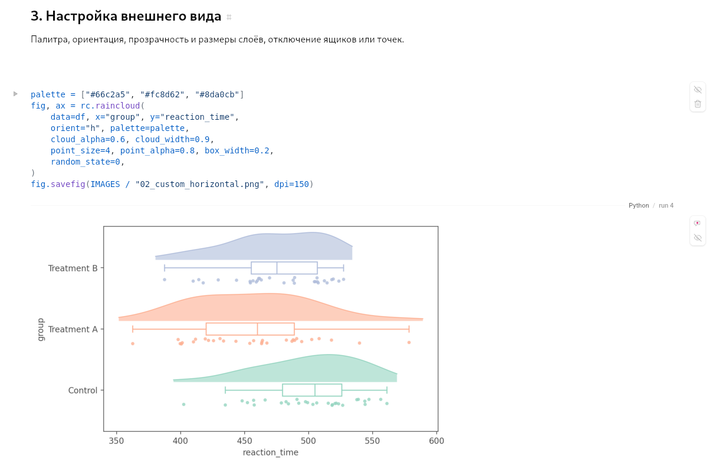

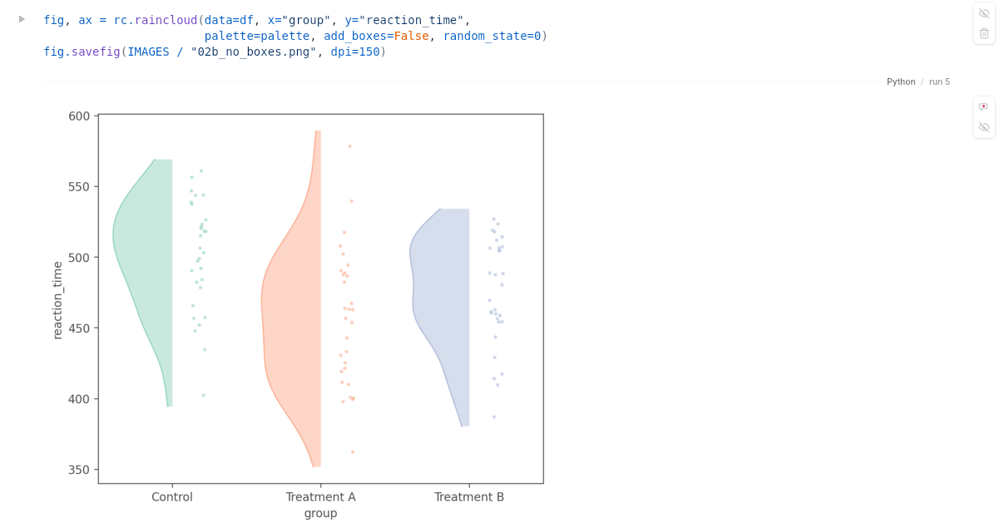

## 4. Основная функция №3

- **Название функции:** донастройка и экспорт результата — функция возвращает стандартные `fig, ax` matplotlib: на график можно добавить заголовок, подписи и отметки значимости, а потом сохранить его в PNG или PDF.
- **Зачем она нужна:** замыкает путь от данных до готовой иллюстрации в статье. Никакого нового API — всё, что пользователь умеет в matplotlib, работает и здесь. Несколько графиков можно собрать на одной фигуре через параметр `ax=`.

### Пошаговая инструкция

1. Сохраните результат вызова: `fig, ax = rc.raincloud(data=df, x="group", y="reaction_time")`.
2. Оформите график методами matplotlib: `ax.set_title(...)`, `ax.set_ylabel(...)`, отметка значимости — `ax.annotate(...)`.
3. Сохраните файл: `fig.savefig("raincloud_plot.pdf", dpi=300, bbox_inches="tight")` — файл появится в текущей папке. Формат определяется расширением: `.pdf`, `.png`, `.svg`, `.tiff`.
4. Чтобы разместить несколько графиков рядом, создайте оси заранее и передайте их: `fig, (ax1, ax2) = plt.subplots(1, 2)`, затем `rc.raincloud(..., ax=ax1)`.

### Пример результата

Подписанный график с отметкой «p < 0.05» и файлы PDF/PNG 300 dpi, готовые к вставке в статью:

```python
fig, ax = rc.raincloud(data=df, x="group", y="reaction_time",
                       palette=palette, random_state=0)
ax.set_title("Reaction Time by Treatment Group", fontsize=14, fontweight="bold")
ax.set_xlabel("Treatment Group")
ax.set_ylabel("Reaction Time (ms)")
ax.plot([0, 0, 1, 1], [612, 620, 620, 612], color="black", linewidth=1)
ax.annotate("p < 0.05", xy=(0.5, 622), ha="center", va="bottom")
fig.savefig("raincloud_plot.pdf", dpi=300, bbox_inches="tight")
```

### Скриншоты

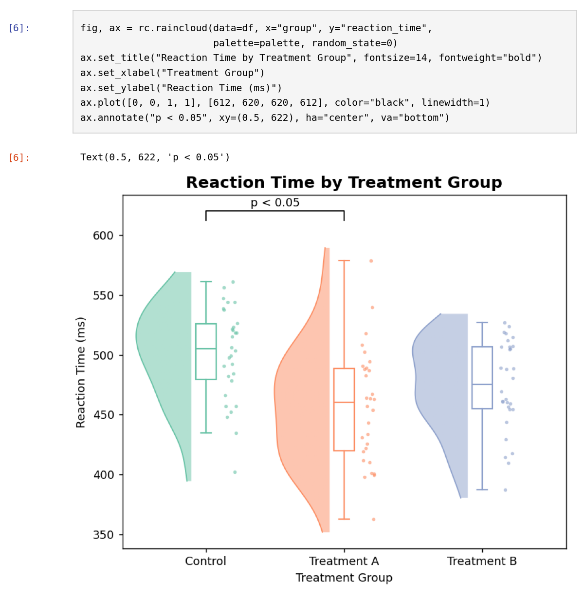

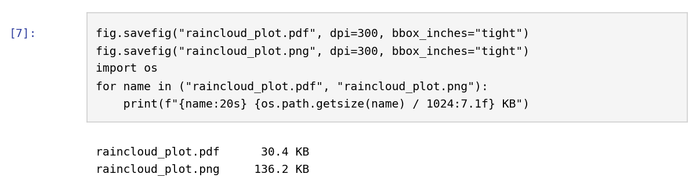

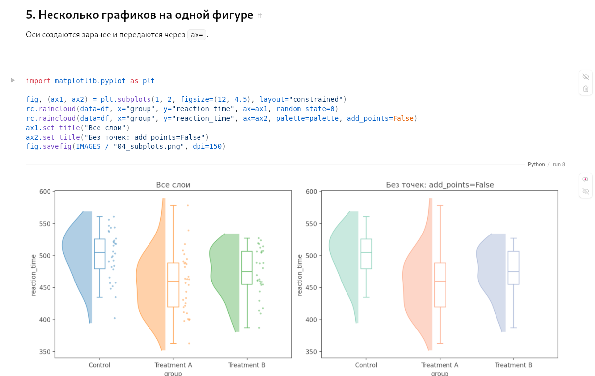

## 5. Что делать, если что-то пошло не так

**Ошибка №1:** `ValueError: Column 'condition' not found in data`\
→ **Что делать:** имя колонки в `x` или `y` написано не так, как в таблице. Посмотрите точные имена командой `print(df.columns)` — важны регистр и пробелы.

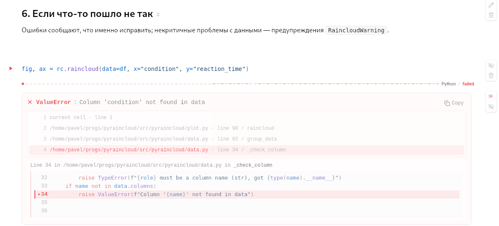

**Ошибка №2:** `ValueError: palette has 2 colour(s) but data has 3 group(s)`\
→ **Что делать:** в палитре меньше цветов, чем групп. Добавьте цвета или уберите `palette` — тогда цвета подберутся автоматически.

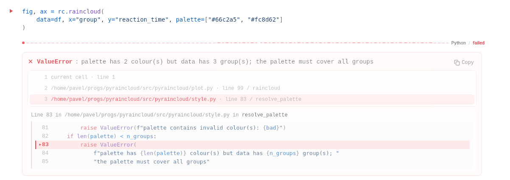

**Ошибка №3:** `TypeError: Column 'reaction_time' must be numeric`\
→ **Что делать:** в колонке не нашлось ни одного числа — чаще всего числа записаны с запятой («512,3») или выбрана не та колонка. Читайте файл с `pd.read_csv(..., decimal=",")` или проверьте имя колонки. Отдельные нечисловые значения («n/a», прочерки) ошибкой не считаются: библиотека превращает их в пропуски и выводит предупреждение.

**Предупреждение:** `RaincloudWarning: ... dropped N NaN value(s)`\
→ **Что делать:** это не ошибка — график построен, пустые значения просто исключены. Если пропусков быть не должно, проверьте исходные данные.

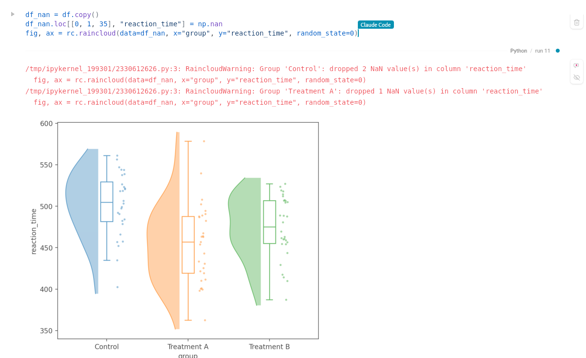

**Ошибка:** `ModuleNotFoundError: No module named 'pyraincloud'`\
→ **Что делать:** библиотека установлена в другое окружение. В Jupyter или nteract выполните `%pip install ...` прямо в ячейке или выберите ядро нужного окружения; с uv запускайте код через `uv run`.

**График не появляется при запуске скрипта**\
→ **Что делать:** библиотека намеренно не открывает окно сама. Добавьте `plt.show()` в конце скрипта или сохраните файл через `fig.savefig(...)`.

**У одной группы нет «облака»**\
→ **Что делать:** в группе одно значение или все значения одинаковы — плотность для неё посчитать нельзя. Библиотека предупреждает об этом и рисует только ящик и точки; добавьте наблюдений, если нужно облако.

## 6. Частые вопросы (FAQ)

**Нужен ли интернет или аккаунт?**\
→ Нет. Библиотека работает полностью на вашем компьютере, ничего не отправляет и не сохраняет без вашей команды.

**Почему точки немного сдвигаются при каждом запуске и как это убрать?**\
→ Точки специально разносятся случайным образом, чтобы не перекрываться. Передайте `random_state=0` (или любое число) — расположение станет одинаковым.

**Как задать свой порядок групп?**\
→ Сделайте колонку категориальной: `df["group"] = pd.Categorical(df["group"], categories=["Treatment B", "Control", "Treatment A"])`. По умолчанию группы идут в порядке появления в данных.

**Можно ли автоматически посчитать p-value?**\
→ В версии 0.1.0 нет: посчитайте статистику в SciPy (например, `scipy.stats.ttest_ind`) и нанесите результат через `ax.annotate`, как в разделе 4.

**Мои данные «широкие» — каждая группа в своей колонке. Что делать?**\
→ Переведите их в длинный формат одной строкой: `long = df.melt(var_name="group", value_name="value")`, затем `rc.raincloud(data=long, x="group", y="value")`.

**Какие версии Python и библиотек поддерживаются?**\
→ Python 3.9 и новее, pandas ≥ 1.5, matplotlib ≥ 3.5, numpy, scipy. Тесты в CI проходят на Linux, macOS и Windows, на Python 3.9–3.13 и на минимальных версиях зависимостей.
